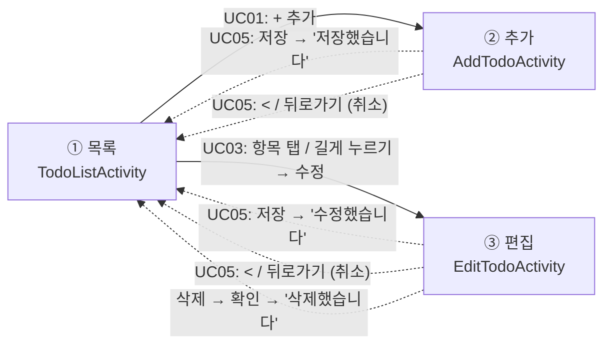
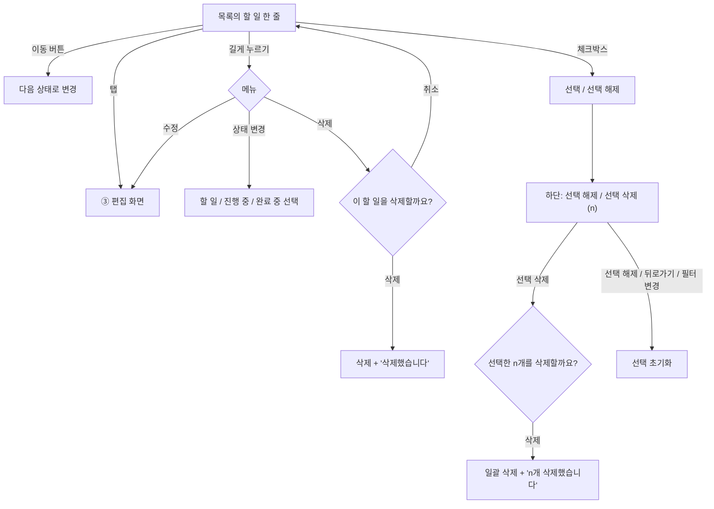
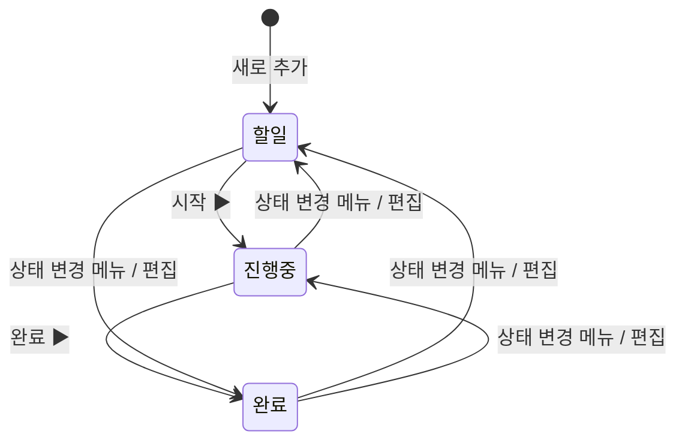

# 03. 사용 흐름

## 사용 흐름 목록
UC01~UC05는 교안의 흐름, UC06~UC07은 추가 기능입니다.

| 코드 | 흐름 | 관련 기능 |
|---|---|---|
| UC01 | ① 목록에서 `+ 추가` → ② 추가 화면 | F1.2 |
| UC02 | ① 목록에서 이동 버튼(`시작 ▶`/`완료 ▶`) 또는 길게 누르기 → `상태 변경` → 즉시 반영 | F1.4, F1.6 |
| UC03 | ① 목록에서 항목 탭 또는 길게 누르기 → `수정` → ③ 편집 화면 | F1.4 |
| UC04 | ① 목록에서 길게 누르기 → `삭제` → 확인 후 삭제 | F1.5 |
| UC05 | ②/③에서 `저장` 또는 상단 `<`·기기 뒤로가기(취소) → ① 목록으로 복귀 | F1.3, F1.4 |
| UC06 | ① 목록에서 필터 버튼 선택 → 해당 상태의 할 일만 표시 | 추가 기능 |
| UC07 | ① 목록에서 체크박스로 여러 개 선택 → `선택 삭제 (n)` → 확인 후 일괄 삭제 | 추가 기능, F1.5 |

## 화면 이동도

화면 간 데이터 전달은 교안 방식 그대로입니다.
- 목록 → 편집: `Intent`에 `EXTRA_ID`(할 일 id)만 담아서 보냄
  - Next.js로 치면 `router.push('/edit?id=3')`
- 편집 화면은 그 id로 DB에서 기존 값을 직접 읽어 옴
- 추가/편집 → 목록: 입력값을 `Intent`에 담아 `setResult(RESULT_OK)`로 돌려줌
  - 목록 화면의 `addTodoLauncher` / `editTodoLauncher`가 받아서 ViewModel에 저장 요청
  - 취소하면 `RESULT_CANCELED` → 아무것도 안 함

## 목록 화면 안에서의 흐름

## 상태 전이도

- 자주 쓰는 정방향(할 일 → 진행 중 → 완료)은 이동 버튼 한 번
- 거꾸로 가거나 단계를 건너뛰는 건 덜 자주 쓰니 메뉴나 편집 화면에서
- 코드: `TodoStatus.next()` — `TODO → IN_PROGRESS → DONE → null`(완료 다음은 없음, 그래서 완료 항목은 버튼이 숨겨짐)

## 상태별 화면 표시 (F1.6)
| 상태 | 제목 | 흐림 | 이동 버튼 |
|---|---|---|---|
| 할 일 (`TODO`) | 그대로 | 아니오 | `시작 ▶` |
| 진행 중 (`IN_PROGRESS`) | `[진행 중] 제목` | 아니오 | `완료 ▶` |
| 완료 (`DONE`) | 취소선 | 예 (50%) | 없음 |
