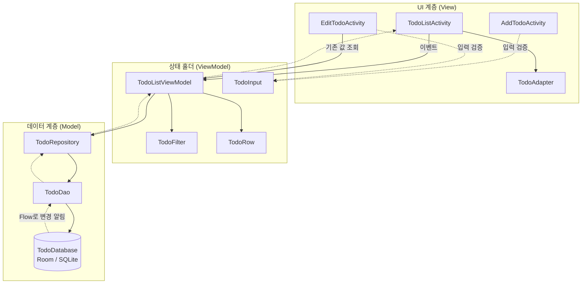
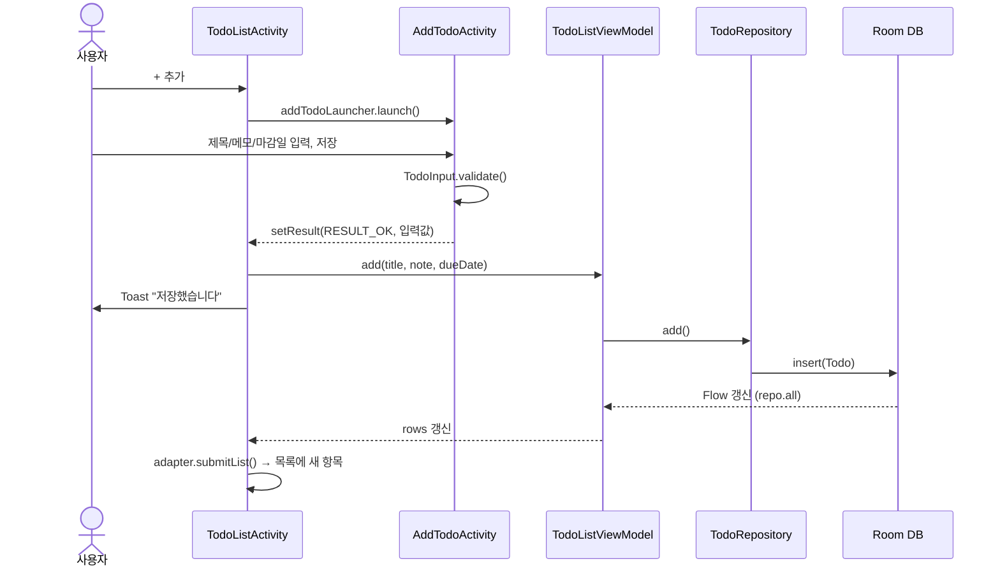
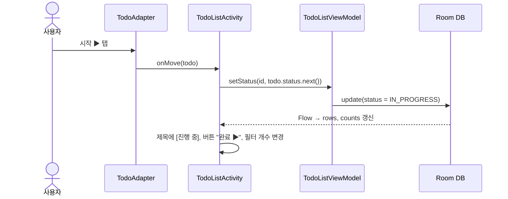
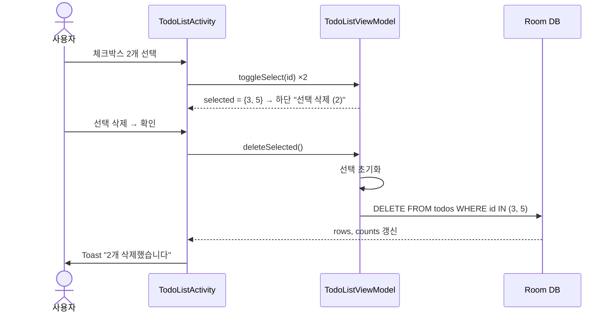

# 04. 앱 구조

## Android ↔ React/Next 용어 대응
| Android | React/Next로 치면 |
|---|---|
| Activity | 페이지 하나 (`app/xxx/page.tsx`) |
| XML 레이아웃 (`res/layout/*.xml`) | 그 페이지의 JSX/HTML 마크업 |
| ViewBinding | XML 요소를 코드에서 타입 안전하게 꺼내 쓰는 것 (`useRef`로 DOM 잡기) |
| RecyclerView + Adapter | `list.map(item => <TodoItem />)` + 가상 스크롤 |
| ListAdapter + DiffUtil | React의 `key` 기반 비교로 바뀐 줄만 다시 그리기 |
| ViewModel | 페이지 상태를 들고 있는 스토어 (Zustand 등). 화면 회전해도 유지 |
| Flow / StateFlow | 구독 가능한 상태 (Observable). 값이 바뀌면 구독자에게 알림 |
| `combine(a, b, c)` | `useMemo(() => f(a, b, c), [a, b, c])` |
| Room (Entity / DAO / Database) | Prisma (모델 / 쿼리 함수 / 클라이언트). DB는 폰 안의 SQLite |
| Repository | `lib/todoService.ts` 같은 데이터 접근 계층 |
| Intent + ActivityResult | `router.push()`로 이동하고 결과를 돌려받기 |
| AlertDialog | 모달 / `window.confirm` |
| Toast | 토스트 알림 |
| `strings.xml` / `colors.xml` / `themes.xml` | i18n 메시지 파일 / CSS 색상 변수 / 전역 테마 |
| Gradle (`build.gradle.kts`, `libs.versions.toml`) | `package.json` + 버전 고정 |
| KSP | 빌드 시 코드 생성기 (Room 구현 코드를 자동 생성. `prisma generate`와 비슷) |
| AndroidManifest.xml | 라우트(화면) 등록 + 시작 화면 지정 |

## 계층 구조 (MVVM)

교안의 계층형 아키텍처(UI Layer → Data Layer)와 MVVM 패턴을 그대로 따릅니다.



| 계층 | 역할 | 이 앱의 파일 |
|---|---|---|
| View | 화면을 그리고 사용자 입력을 받음. 로직 없이 ViewModel에 전달 | `ui/*Activity.kt`, `TodoAdapter.kt`, `res/layout/*.xml` |
| ViewModel | 화면 상태(목록, 필터, 선택)를 보관하고 이벤트 처리 | `vm/TodoListViewModel.kt` |
| (순수 로직) | 안드로이드와 무관한 계산 → 단위 테스트 대상 | `vm/TodoFilter.kt`, `vm/TodoRow.kt`, `vm/TodoInput.kt` |
| Repository | UI가 DB를 직접 몰라도 되게 데이터 접근을 감쌈 | `data/TodoRepository.kt` |
| Data Source | 실제 DB 접근 | `data/local/TodoDao.kt`, `TodoDatabase.kt`, `Todo.kt` |

## 파일별 역할

```
app/src/main/java/com/k0h5/todolist
├── data
│   ├── local
│   │   ├── Todo.kt            @Entity — DB 테이블 한 줄 (할 일 한 건)
│   │   ├── TodoStatus.kt      상태 enum (TODO / IN_PROGRESS / DONE) + next()
│   │   ├── TodoDao.kt         @Dao — observeAll / insert / update / delete / deleteByIds / getById
│   │   └── TodoDatabase.kt    @Database — DB 싱글톤 get(context)
│   └── TodoRepository.kt      add / update / setStatus / delete / deleteAll / getById
├── vm
│   ├── TodoListViewModel.kt   rows, counts, filter, selected + 이벤트 함수
│   ├── TodoFilter.kt          ALL / TODO / IN_PROGRESS / DONE, apply(list), countAll(list)
│   ├── TodoRow.kt             목록 한 줄 = 할 일 + 선택 여부
│   └── TodoInput.kt           validate(), earliestDue()
└── ui
    ├── TodoListActivity.kt    ① 목록 화면
    ├── AddTodoActivity.kt     ② 추가 화면
    ├── EditTodoActivity.kt    ③ 편집 화면
    ├── TodoAdapter.kt         목록 한 줄 그리기 (상태별 스타일 = F1.6)
    ├── DuePicker.kt           마감일 칸 → 달력, 날짜 문자열 변환
    ├── Dialogs.kt             삭제 확인 창 (삭제 글자 색)
    ├── InputErrors.kt         검증 오류 → 안내 문구
    └── Insets.kt              상태바/키보드에 가리지 않게 여백 처리

app/src/main/res
├── layout                     activity_todo_list / activity_add_todo / activity_edit_todo / item_todo
├── values                     strings.xml / colors.xml / themes.xml
└── AndroidManifest.xml (상위 폴더)
```

## ViewModel이 들고 있는 상태

```kotlin
_filter   : MutableStateFlow<TodoFilter>   // 현재 필터 (기본 ALL)
_selected : MutableStateFlow<Set<Long>>    // 체크박스로 고른 id들

rows   = combine(repo.all, _filter, _selected) { list, f, sel -> TodoRow.of(f.apply(list), sel) }
counts = repo.all.map { TodoFilter.countAll(it) }
```

React로 쓰면 대략 이렇습니다.
```ts
const todos = useLiveQuery(db.todos)                 // repo.all
const [filter, setFilter] = useState('ALL')
const [selected, setSelected] = useState(new Set())
const rows = useMemo(() => applyFilter(todos, filter).map(t => ({ todo: t, selected: selected.has(t.id) })),
                     [todos, filter, selected])
```

목록 화면은 `rows`, `counts`, `selected` 세 개를 구독합니다.
- `rows` → `adapter.submitList(rows)` (목록 다시 그림) + 빈 목록 안내 표시 여부
- `counts` → 필터 버튼 글자 `전체 (4)` 갱신
- `selected` → 하단 버튼(`+ 추가` ↔ `선택 해제`/`선택 삭제 (n)`) 전환

## 데이터 흐름 예시

### 할 일 추가 (UC01 → UC05)


### 이동 버튼 (UC02)


### 선택 일괄 삭제 (UC07)


## 사용 라이브러리 (`gradle/libs.versions.toml`)
| 라이브러리 | 용도 |
|---|---|
| androidx.appcompat, material | 기본 위젯, 테마, 상단 바(MaterialToolbar), 버튼 |
| androidx.activity-ktx | `by viewModels()`, 뒤로가기 처리, 결과 받기 |
| androidx.recyclerview | 목록 |
| androidx.lifecycle (viewmodel, runtime) | ViewModel, `lifecycleScope`, `repeatOnLifecycle` |
| androidx.room (runtime, ktx, compiler) | 로컬 DB |
| KSP 플러그인 | Room 코드 생성 |
| junit | 단위 테스트 |
